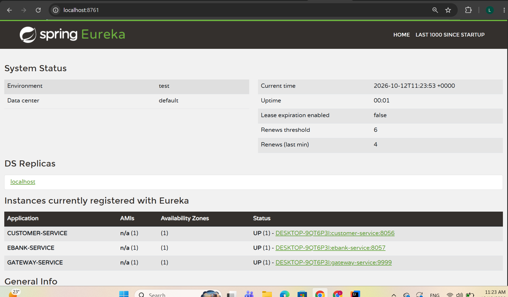
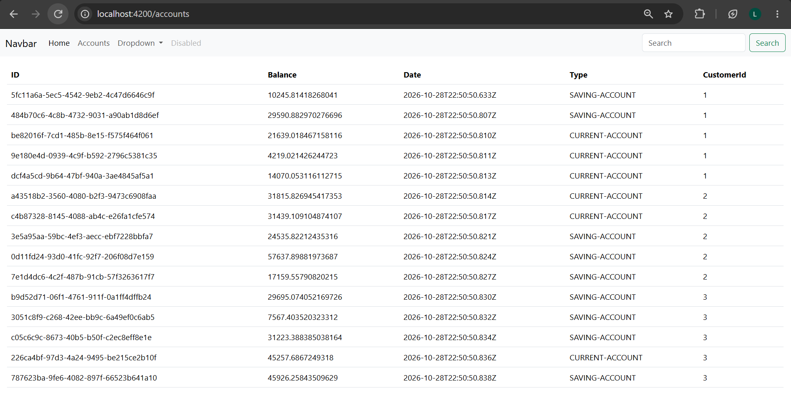
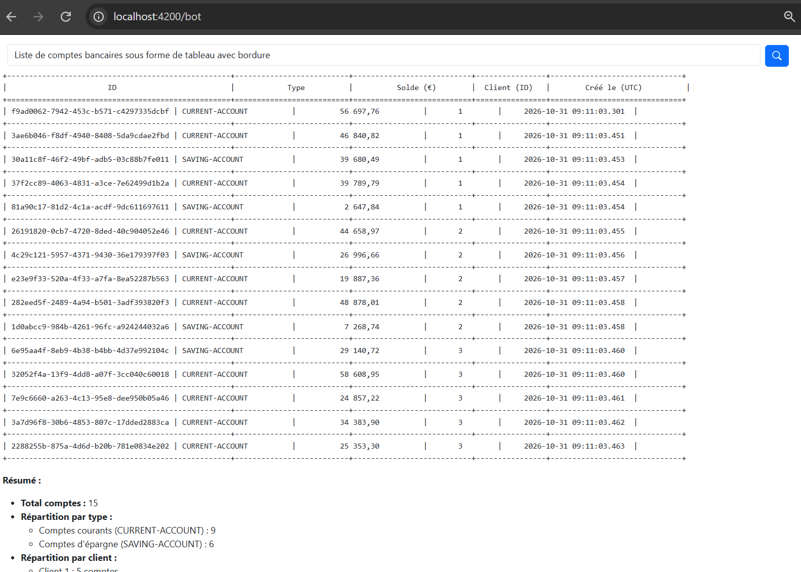

# EBank Microservices App


---

## Table des matières

1. [Présentation du projet](#1-présentation-du-projet)
2. [Rapports détaillés](#2-rapports-détaillés)
3. [Architecture globale](#3-architecture-globale)
4. [Technologies utilisées](#4-technologies-utilisées)
5. [Services et ports](#5-services-et-ports)
6. [Structure du dépôt](#6-structure-du-dépôt)
7. [Ordre de démarrage](#7-ordre-de-démarrage)
8. [Aperçu du projet](#8-aperçu-du-projet)
9. [Configuration et sécurité](#9-configuration-et-sécurité)
10. [Conclusion](#10-conclusion)

---

## 1. Présentation du projet

EBank Microservices App est une application bancaire distribuée construite autour d'une architecture micro-services. Elle permet de gérer des clients et leurs comptes bancaires, et d'interagir avec ces données de trois manières complémentaires : par des API REST, par un agent conversationnel basé sur l'intelligence artificielle, et par une interface web Angular.

Le projet est organisé en trois parties, chacune faisant l'objet d'un rapport détaillé :

- **Partie 1** : la base de l'architecture micro-services (services métier, annuaire, passerelle, communication inter-services, tolérance aux pannes) ;
- **Partie 2** : l'agent IA EBank-Bot, qui exploite les micro-services via le protocole MCP et qui est accessible depuis Discord et Telegram ;
- **Partie 3** : l'application front-end Angular, qui consomme les API via la Gateway et propose une interface de chat avec réponses en streaming.

---

## 2. Rapports détaillés

Chaque partie est documentée dans un rapport dédié, avec les étapes de réalisation, les choix techniques et les captures d'écran des tests.

| Partie | Thème | Contenu principal | Rapport |
|--------|-------|-------------------|---------|
| 1 | Micro-services | Customer-Service, EBank-Service, Eureka, Gateway, OpenFeign, Resilience4J | [Lire le rapport](docs/Partie1-Microservices.md) |
| 2 | Agent IA | Spring AI, MCP (serveurs et client), mémoire conversationnelle, Discord, Telegram | [Lire le rapport](docs/Partie2-EBank-Bot.md) |
| 3 | Front-end | Angular 21, Bootstrap, CORS, intercepteur HTTP, chatbot, Markdown, streaming | [Lire le rapport](docs/Partie3-Angular-Front.md) |

---

## 3. Architecture globale

```
                        +---------------------------+
                        |   Angular (port 4200)     |
                        |   Comptes + Chatbot       |
                        +-------------+-------------+
                                      |
        Discord / Telegram            | HTTP (CORS)
              |                       v
              |           +---------------------------+
              |           |   Gateway (port 9999)     |
              |           |   Routage dynamique       |
              |           +-----+---------------+-----+
              |                 |               |
              v                 v               v
      +---------------+  +-------------+  +----------------+
      | EBank-Bot     |  | Customer-   |  | EBank-Service  |
      | (port 8058)   |  | Service     |  | (port 8057)    |
      | Spring AI     |  | (port 8056) |  | Comptes        |
      +-------+-------+  +------+------+  +--------+-------+
              |                 ^                  |
              |   MCP           | OpenFeign        |
              +-----------------+------------------+
                                   (Resilience4J)

        Tous les services s'enregistrent auprès de
        Discovery Service - Eureka (port 8761)
```

Principes de l'architecture :

- chaque service est indépendant, avec sa propre base de données H2 ;
- les services s'enregistrent auprès d'Eureka et se découvrent par leur nom, sans adresse codée en dur ;
- la Gateway est le point d'entrée unique et route les requêtes dynamiquement vers les services ;
- EBank-Service interroge Customer-Service via OpenFeign, protégé par un circuit breaker Resilience4J avec réponse de repli ;
- les deux micro-services métier sont exposés comme outils MCP, ce qui permet à l'agent IA de les utiliser pour répondre en langage naturel.

---

## 4. Technologies utilisées

| Domaine | Technologies |
|---------|--------------|
| Back-end | Java 21, Spring Boot 3.5.10, Maven (multi-modules), Spring Data JPA, H2, Lombok |
| Micro-services | Spring Cloud : Eureka (Discovery), Gateway, OpenFeign |
| Résilience | Resilience4J (Circuit Breaker, fallback) |
| Documentation d'API | SpringDoc OpenAPI (Swagger), Actuator |
| Intelligence artificielle | Spring AI, OpenAI, ChatClient, ChatMemory, MCP (serveur et client) |
| Messagerie | Bot Telegram, bot Discord |
| Front-end | Angular 21, Node 22, Bootstrap 5, RxJS, ngx-markdown |

---

## 5. Services et ports

| Service | Rôle | Port |
|---------|------|------|
| Discovery Service | Annuaire Eureka | 8761 |
| Gateway | Point d'entrée unique et routage | 9999 |
| Customer-Service | Gestion des clients | 8056 |
| EBank-Service | Gestion des comptes bancaires | 8057 |
| EBank-Bot | Agent IA, serveur MCP client, connecteurs | 8058 |
| Front-end Angular | Interface web | 4200 |

---

## 6. Structure du dépôt

```
Ebank-ms-app/
├── README.md                    -> présentation générale (ce fichier)
├── docs/
│   ├── Partie1-Microservices.md -> rapport de la Partie 1
│   ├── Partie2-EBank-Bot.md     -> rapport de la Partie 2
│   └── Partie3-Angular-Front.md -> rapport de la Partie 3
├── screens/                     -> captures d'écran utilisées par les rapports
├── Discovery-Service/
├── Gateway-Service/
├── Customer-Service/
├── EBank-Service/
├── ebank-bot/
└── ebank-front/                 -> application Angular
```

Les noms exacts des dossiers peuvent être adaptés à ceux du dépôt.

---

## 7. Ordre de démarrage

Les services doivent être lancés dans l'ordre suivant :

1. **Discovery Service** (Eureka), accessible sur `http://localhost:8761` ;
2. **Customer-Service** et **EBank-Service** ;
3. **Gateway**, accessible sur `http://localhost:9999` ;
4. **EBank-Bot**, après avoir renseigné les variables d'environnement décrites ci-dessous ;
5. **Front-end Angular**, avec `npm install` puis `ng serve`, accessible sur `http://localhost:4200`.

Prérequis : JDK 21, Maven, Node.js 22 et le CLI Angular.

---

## 8. Aperçu du projet

### Enregistrement des services dans Eureka



### Interface Angular : liste des comptes



### Chatbot dans l'interface Angular, avec streaming



### Agent IA sur Telegram


Les tests complets figurent dans les rapports détaillés.

---

## 9. Configuration et sécurité

L'agent EBank-Bot nécessite des clés et des jetons d'accès : clé API OpenAI, jeton du bot Telegram et jeton du bot Discord. Ces valeurs ne doivent jamais être enregistrées dans le dépôt Git. Elles doivent être fournies par des variables d'environnement ou par un fichier de configuration local exclu du suivi par `.gitignore`.

Si une clé a été publiée par erreur dans l'historique du dépôt, elle doit être révoquée et remplacée immédiatement.

---

## 10. Conclusion

Le projet couvre l'ensemble d'une chaîne applicative moderne : des micro-services découverts dynamiquement et protégés contre les pannes, un agent IA qui utilise ces services comme outils via MCP et qui est joignable depuis plusieurs canaux, et une interface web Angular offrant consultation des comptes et conversation avec réponses en streaming.

Pour le détail de chaque étape, se reporter aux trois rapports :

- [Partie 1 - Micro-services](docs/Partie1-Microservices.md)
- [Partie 2 - EBank-Bot (Agent IA et MCP)](docs/Partie2-EBank-Bot.md)
- [Partie 3 - Application front-end Angular](docs/Partie3-Angular-Front.md)
