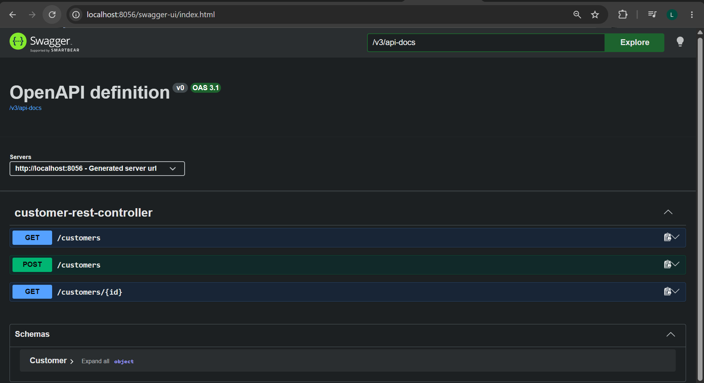
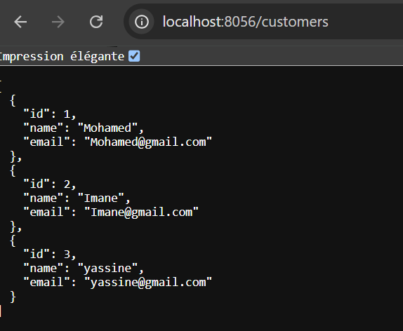
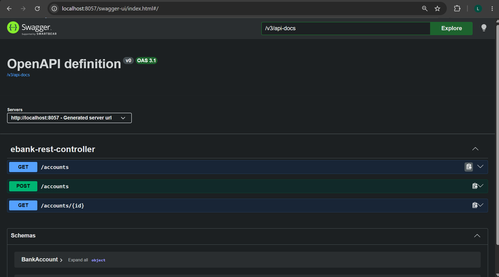
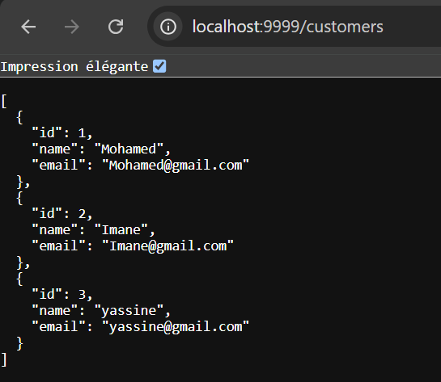
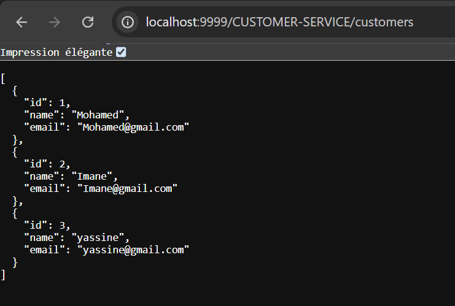
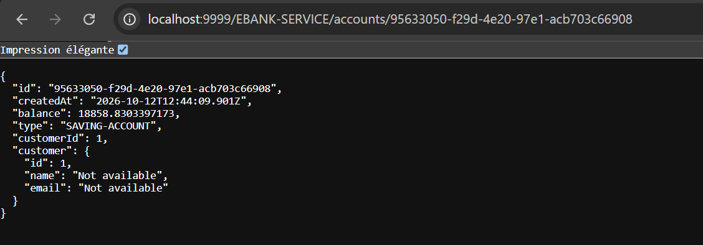

# EBank Microservices App : Partie 1 - Micro-services


---

## Sommaire

1. [Objectif de la Partie 1](#1--objectif-de-la-partie-1)
2. [Architecture globale](#2--architecture-globale)
3. [Technologies utilisées](#3--technologies-utilisées)
4. [Structure du projet](#4--structure-du-projet)
5. [Customer-Service](#5--customer-service)
6. [EBank-Service](#6--ebank-service)
7. [Discovery Service (Eureka)](#7--discovery-service-eureka)
8. [Gateway Service](#8--gateway-service)
9. [Communication inter-services avec OpenFeign](#9--communication-inter-services-avec-openfeign)
10. [Tolérance aux pannes avec Resilience4J](#10--tolérance-aux-pannes-avec-resilience4j)
11. [Tests des services](#11--tests-des-services)
12. [Lancement du projet](#12--lancement-du-projet)
13. [Conclusion](#13--conclusion)

---

## 1. Objectif de la Partie 1

Cette première partie consiste à mettre en place une **architecture microservices** complète pour une application de gestion de comptes bancaires. Elle comprend :

-  Développement du service **Customer-Service**
-  Développement du service **EBank-Service**
-  Communication entre les deux services avec **OpenFeign**
-  Tolérance aux pannes avec le **Circuit Breaker (Resilience4J)**
-  Développement de la **Gateway**
-  Développement du **Discovery Service**
-  Test des services backend avec **Postman** et **Swagger-UI**

---

## 2. Architecture globale

```
                       ┌──────────────────┐
                       │  Client REST /   │
                       │ Swagger / Postman│
                       └────────┬─────────┘
                                │
                       ┌────────▼─────────┐
                       │  Gateway Service │  (port 9999)
                       └────────┬─────────┘
                                │ routage statique / dynamique
              ┌─────────────────┼──────────────────┐
              │                 │                  │
     ┌────────▼────────┐        │         ┌────────▼────────┐
     │ Customer-Service│◄───────┼─────────│  EBank-Service  │
     │   (port 8056)   │ OpenFeign + CB   │   (port 8057)   │
     └────────┬────────┘        │         └────────┬────────┘
              │                 │                  │
              └─────────────────▼──────────────────┘
                       ┌──────────────────┐
                       │ Discovery Service│  (Eureka, port 8761)
                       └──────────────────┘
```

| Microservice | Rôle | Port |
|---|---|---|
| `customer-service` | Gestion des clients | **8056** |
| `ebank-service` | Gestion des comptes bancaires | **8057** |
| `gateway-service` | Point d'entrée unique de l'architecture | **9999** |
| `discovery-service` | Annuaire des services (Eureka Server) | **8761** |

> Un compte bancaire **appartient à un client** : `EBank-Service` interroge `Customer-Service` via **OpenFeign** (communication synchrone REST).

---

## 3. Technologies utilisées

| Catégorie | Technologie |
|---|---|
| Langage | Java 21 |
| Framework | Spring Boot 3.5.10 |
| Build | Maven |
| Persistance | Spring Data JPA + base **H2** (in-memory) |
| Microservices | Spring Cloud (Eureka, Gateway, OpenFeign) |
| Tolérance aux pannes | Resilience4J (Circuit Breaker) |
| Monitoring | Spring Boot Actuator |
| Documentation API | SpringDoc OpenAPI (Swagger UI) |
| Productivité | Lombok |
| Tests | Postman, Swagger UI |

---

## 4. Structure du projet

```
Ebank-ms-app/
├── customer-service/
│   └── src/main/java/.../
│       ├── entities/       → Customer
│       ├── repository/     → CustomerRepository
│       ├── service/        → CustomerService
│       └── web/            → CustomerRestController
├── ebank-service/
│   └── src/main/java/.../
│       ├── entities/       → BankAccount
│       ├── model/          → Customer (classe non persistée)
│       ├── repository/     → BankAccountRepository
│       ├── service/        → EBankService
│       ├── openfeign/      → CustomerRestClient
│       └── web/            → BankAccountRestController
├── gateway-service/
├── discovery-service/
└── screens/                → captures d'écran du rapport
```

---

## 5. Customer-Service

### 5.1 Dépendances principales

`Spring Web` · `Spring Data JPA` · `H2 Database` · `Lombok` · `Eureka Discovery Client` · `Config Client` · `Actuator` · `SpringDoc OpenAPI`

### 5.2 Entité `Customer`

| Attribut | Type | Description |
|---|---|---|
| `id` | `Long` | Identifiant auto-généré |
| `name` | `String` | Nom du client |
| `email` | `String` | Adresse e-mail |

### 5.3 Couches de l'application

- **Entité** : classe JPA annotée `@Entity`, `@Id`, `@GeneratedValue` et Lombok (`@Getter @Setter @NoArgsConstructor @AllArgsConstructor @Builder`).
- **Repository** : `CustomerRepository extends JpaRepository<Customer, Long>`.
- **Service** : `CustomerService` avec trois méthodes :
  - `getAllCustomers()`
  - `findCustomerById(Long id)` — lève une exception si le client n'existe pas
  - `saveCustomer(Customer customer)`
- **Contrôleur REST** : `CustomerRestController`

### 5.4 Endpoints exposés

| Méthode | URL | Description |
|---|---|---|
| `GET` | `/customers` | Liste de tous les clients |
| `GET` | `/customers/{id}` | Consultation d'un client par son ID |
| `POST` | `/customers` | Ajout d'un nouveau client |

### 5.5 Configuration (`application.properties`)

```properties
spring.application.name=customer-service
server.port=8056
spring.datasource.url=jdbc:h2:mem:customers-db
spring.cloud.discovery.enabled=true
spring.cloud.config.enabled=false
```

### 5.6 Jeu de données initial (`CommandLineRunner`)

Trois clients sont insérés au démarrage : **Mohammed**, **Imane** et **Yassin**.

### 5.7 Test avec Swagger UI

 `http://localhost:8056/swagger-ui.html`



### 5.8 Test de l'endpoint `/customers`



---

## 6. EBank-Service

### 6.1 Dépendances principales

`Spring Web` · `Spring Data JPA` · `H2 Database` · `Lombok` · `Eureka Discovery Client` · `Config Client` · `Actuator` · `OpenFeign` · `Resilience4J` · `SpringDoc OpenAPI`

### 6.2 Entité `BankAccount`

| Attribut | Type | Description |
|---|---|---|
| `id` | `String` | Identifiant unique généré (UUID) |
| `createdAt` | `Date` | Date de création (date système) |
| `balance` | `double` | Solde du compte |
| `type` | `String` | Type du compte (`CURRENT_ACCOUNT` ou `SAVING_ACCOUNT`) |
| `customerId` | `Long` | Clé étrangère vers le client (microservice distinct) |
| `customer` | `Customer` | Attribut annoté `@Transient` : non persisté en base, rempli via OpenFeign |

> Les microservices ayant des bases séparées, **l'intégrité référentielle n'est plus assurée par la base de données** mais par la **couche métier** du microservice.

### 6.3 Couche service — `EBankService`

- `getAllBankAccounts()`
- `getBankAccountById(String id)` — récupère le compte, puis enrichit avec les informations du client via OpenFeign
- `saveBankAccount(BankAccount account)` — vérifie l'existence du client avant l'enregistrement, génère l'ID (`UUID.randomUUID()`) et la date de création

### 6.4 Endpoints exposés

| Méthode | URL | Description |
|---|---|---|
| `GET` | `/accounts` | Liste de tous les comptes |
| `GET` | `/accounts/{id}` | Consultation d'un compte (avec les infos du client) |
| `POST` | `/accounts` | Création d'un compte |

### 6.5 Configuration

```properties
spring.application.name=ebank-service
server.port=8057
spring.datasource.url=jdbc:h2:mem:account-db
spring.h2.console.enabled=true
spring.cloud.discovery.enabled=true
spring.cloud.config.enabled=false
```

### 6.6 Jeu de données initial

Pour chacun des **3 clients**, **5 comptes** sont créés avec un type aléatoire et un solde aléatoire (minimum 1000), soit **15 comptes** au total.

### 6.7 Test avec Swagger UI

 `http://localhost:8057/swagger-ui.html`



---

## 7. Discovery Service (Eureka)

### 7.1 Création

Projet Spring Boot avec les dépendances **Eureka Server** et **Actuator**.

### 7.2 Configuration

1. Activer le serveur avec l'annotation `@EnableEurekaServer` sur la classe principale.
2. Configurer `application.properties` :

```properties
server.port=8761
eureka.client.fetch-registry=false
eureka.client.register-with-eureka=false
```

> Ces deux propriétés empêchent le serveur de s'enregistrer lui-même dans son propre registre.

### 7.3 Activation de l'enregistrement côté microservices

Dans `customer-service`, `ebank-service` et `gateway-service`, la propriété `spring.cloud.discovery.enabled` est passée à `true`.

### 7.4 Ordre de démarrage

1. `discovery-service`
2. `customer-service`
3. `ebank-service` et `gateway-service`

### 7.5 Tableau de bord Eureka

 `http://localhost:8761`

Les trois microservices (`CUSTOMER-SERVICE`, `EBANK-SERVICE`, `GATEWAY-SERVICE`) apparaissent bien enregistrés :


---

## 8. Gateway Service

Dépendances : **Reactive Gateway**, **Eureka Discovery Client**, **Actuator**.  
Port : `9999`

La Gateway est le **point d'entrée unique** : les clients ne contactent plus directement les microservices.

### 8.1 Routage statique (`application.yml`)

```yaml
server:
  port: 9999
spring:
  cloud:
    gateway:
      server:
        webflux:
          routes:
            - id: r1
              uri: http://localhost:8056
              predicates:
                - Path=/customers/**
            - id: r2
              uri: http://localhost:8057
              predicates:
                - Path=/accounts/**
```

> **Attention à la syntaxe YAML** : il ne faut pas d'espace entre `Path` et `=`, sinon le prédicat n'est pas reconnu.

**Test :** `http://localhost:9999/customers`



### 8.2 Routage dynamique (via Discovery Service)

La configuration statique est mise en commentaire et remplacée par un bean :

```java
@Bean
DiscoveryClientRouteDefinitionLocator dynamicRoutes(
        ReactiveDiscoveryClient rdc,
        DiscoveryLocatorProperties dlp) {
    return new DiscoveryClientRouteDefinitionLocator(rdc, dlp);
}
```

Les routes sont alors créées **automatiquement** à partir des noms des microservices enregistrés dans Eureka :

| Service | URL via la Gateway |
|---|---|
| Customer-Service | `http://localhost:9999/CUSTOMER-SERVICE/customers` |
| EBank-Service | `http://localhost:9999/EBANK-SERVICE/accounts` |



---

## 9. Communication inter-services avec OpenFeign

`EBank-Service` a besoin des informations du client associé à un compte. On utilise **OpenFeign**, un client REST **déclaratif** : il suffit de déclarer une interface.

### 9.1 Interface `CustomerRestClient`

```java
@FeignClient(name = "CUSTOMER-SERVICE")
public interface CustomerRestClient {

    @GetMapping("/customers/{id}")
    Customer getCustomerById(@PathVariable Long id);
}
```

- Le **nom du service** (`CUSTOMER-SERVICE`) est résolu par le **Discovery Service**.
- La réponse est désérialisée dans la classe `model.Customer` (non persistée).

### 9.2 Activation

Ajout de l'annotation `@EnableFeignClients` sur la classe principale d'`EBank-Service`. Sans elle, l'interface n'est pas implémentée et l'injection échoue au démarrage.

### 9.3 Utilisation dans la couche service

```java
BankAccount account = bankAccountRepository.findById(id)
        .orElseThrow(() -> new RuntimeException("Account not found"));
Customer customer = customerRestClient.getCustomerById(account.getCustomerId());
account.setCustomer(customer);
return account;
```

### 9.4 Vérification de l'existence du client à la création d'un compte

Avant l'enregistrement, le service interroge `Customer-Service` dans un bloc `try/catch`. Si le client n'existe pas (ou si le service est injoignable), une `RuntimeException` est levée et le compte n'est pas créé.

---

## 10. Tolérance aux pannes avec Resilience4J

### 10.1 Principe du Circuit Breaker

Lorsqu'un service distant est indisponible, le **Circuit Breaker** évite de lui envoyer des requêtes vouées à l'échec et renvoie une **réponse par défaut** (*fallback*) :

- **État CLOSED** : les appels passent normalement.
- **État OPEN** : après un certain nombre d'échecs, les appels sont directement redirigés vers le fallback.
- **État HALF-OPEN** : après un délai, quelques appels sont retestés ; en cas de succès, le circuit se referme.

### 10.2 Configuration

Dépendance **Resilience4J** ajoutée dans `EBank-Service`, puis annotation de la méthode Feign :

```java
@FeignClient(name = "CUSTOMER-SERVICE")
public interface CustomerRestClient {

    @GetMapping("/customers/{id}")
    @CircuitBreaker(name = "customerService", fallbackMethod = "getDefaultCustomer")
    Customer getCustomerById(@PathVariable Long id);

    default Customer getDefaultCustomer(Long id, Exception e) {
        return Customer.builder()
                .id(id)
                .name("Not Available")
                .email("Not Available")
                .build();
    }
}
```

> La méthode de fallback doit avoir **les mêmes paramètres que la méthode d'origine, suivis de l'exception**.

### 10.3 Scénario de test

1. `Customer-Service` **démarré** → le compte est renvoyé avec les vraies informations du client.
2. `Customer-Service` **arrêté** (simulation d'une panne) → le compte est quand même renvoyé, avec `Not Available` pour les informations du client, **sans erreur côté utilisateur**.
3. `Customer-Service` **redémarré** → après le délai du circuit breaker, les vraies données réapparaissent.



---

## 11. Tests des services

| Outil | Usage |
|---|---|
| **Swagger UI** | Test interactif des endpoints de chaque service |
| **Postman** | Tests des requêtes `GET` / `POST` via la Gateway |
| **Navigateur** | Consultation rapide des endpoints `GET` |
| **Eureka Dashboard** | Vérification de l'enregistrement des services |

Exemple de requête `POST /accounts` (sans `id` ni `createdAt`, générés par la couche métier) :

```json
{
  "balance": 5000,
  "type": "CURRENT_ACCOUNT",
  "customerId": 2
}
```

---

## 12. ▶ Lancement du projet

### Prérequis

- JDK 21
- Maven 3.9+

### Étapes

```bash
# 1. Cloner le dépôt
git clone https://github.com/latifa-mtl/Ebank-ms-app.git
cd Ebank-ms-app

# 2. Démarrer les services dans cet ordre (un terminal par service)
cd discovery-service && mvn spring-boot:run     # 8761
cd customer-service  && mvn spring-boot:run     # 8056
cd ebank-service     && mvn spring-boot:run     # 8057
cd gateway-service   && mvn spring-boot:run     # 9999
```

### URLs utiles

| Ressource | URL |
|---|---|
| Eureka Dashboard | http://localhost:8761 |
| Swagger Customer-Service | http://localhost:8056/swagger-ui.html |
| Swagger EBank-Service | http://localhost:8057/swagger-ui.html |
| Clients via Gateway | http://localhost:9999/CUSTOMER-SERVICE/customers |
| Comptes via Gateway | http://localhost:9999/EBANK-SERVICE/accounts |

---

## 13. Conclusion

Cette première partie a permis de construire le **socle d'une architecture microservices** :

- deux microservices fonctionnels (`Customer-Service`, `EBank-Service`) ;
- un annuaire de services (**Eureka**) et une **Gateway** avec routage statique puis dynamique ;
- une communication synchrone déclarative avec **OpenFeign** ;
- une **tolérance aux pannes** grâce au Circuit Breaker de **Resilience4J**.

