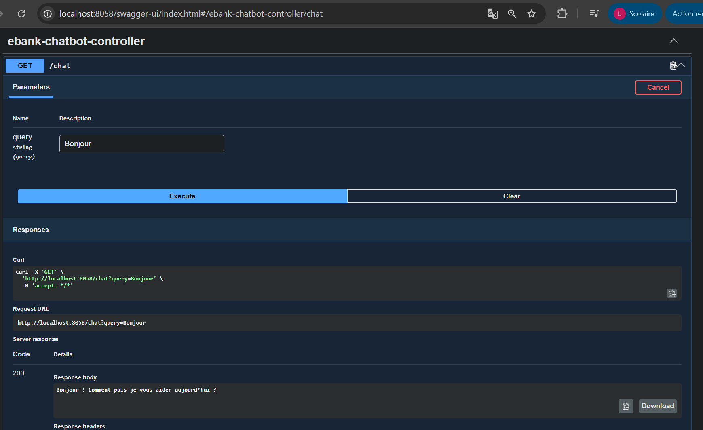
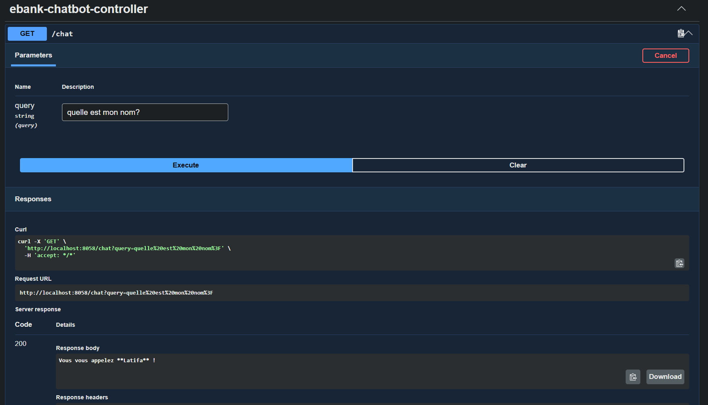
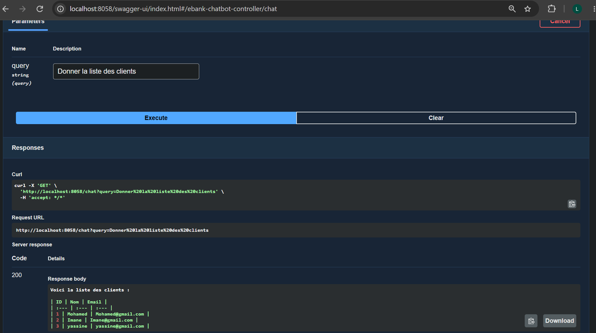
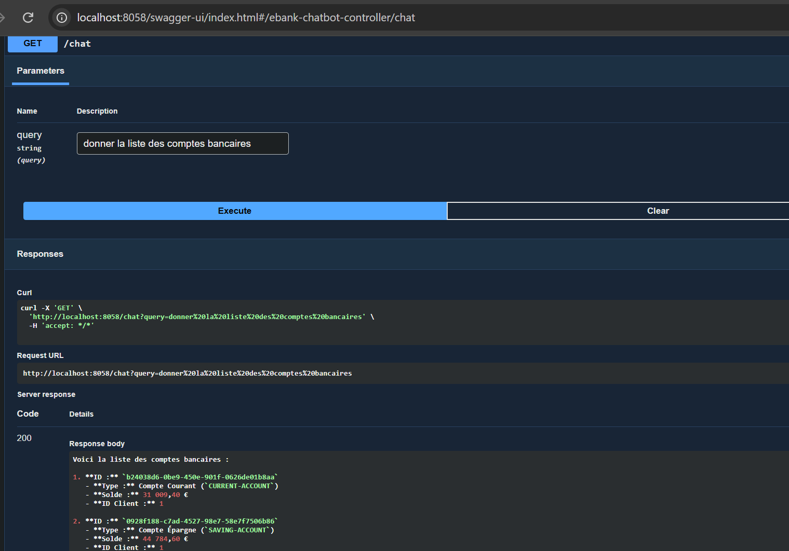
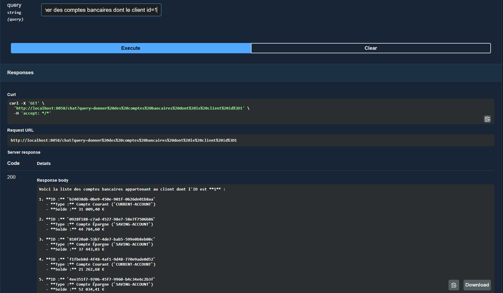
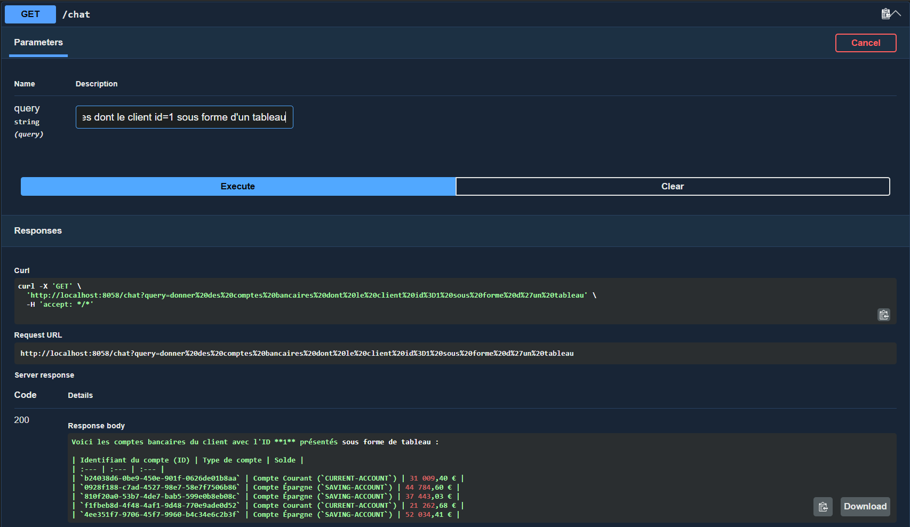
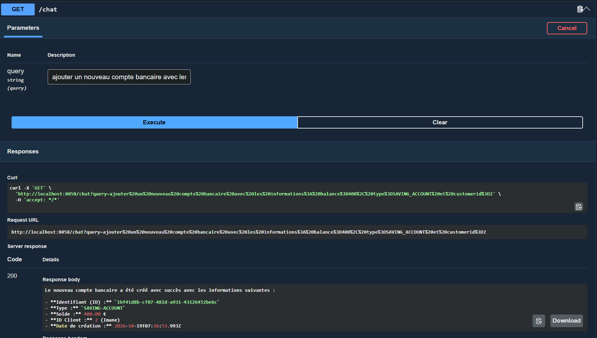
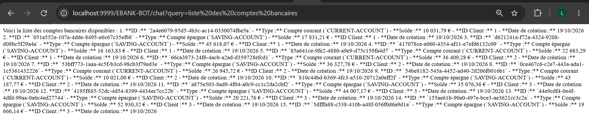
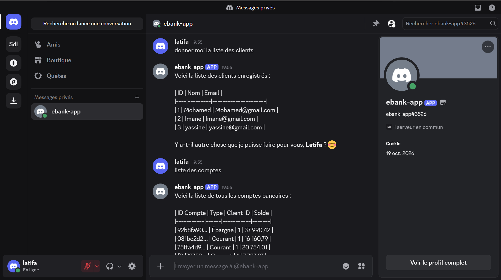
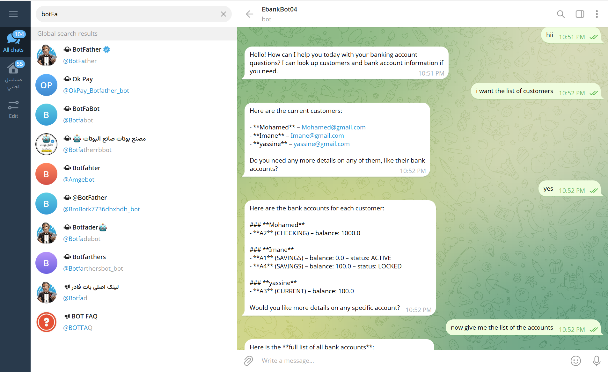

# EBank Microservices App : Partie 2 - EBank-Bot (Agent IA et MCP)

---

## Table des matières

1. [Objectif de la Partie 2](#1-objectif-de-la-partie-2)
2. [Architecture globale](#2-architecture-globale)
3. [Technologies utilisées](#3-technologies-utilisées)
4. [Création du micro-service EBank-Bot](#4-création-du-micro-service-ebank-bot)
5. [Premier contrôleur et communication avec le LLM](#5-premier-contrôleur-et-communication-avec-le-llm)
6. [Mémoire conversationnelle](#6-mémoire-conversationnelle)
7. [Séparation de l'agent et du contrôleur](#7-séparation-de-lagent-et-du-contrôleur)
8. [Exposition des micro-services via MCP (serveurs MCP)](#8-exposition-des-micro-services-via-mcp-serveurs-mcp)
9. [Connexion de l'agent aux serveurs MCP (client MCP)](#9-connexion-de-lagent-aux-serveurs-mcp-client-mcp)
10. [Délimitation du champ d'application par le prompt système](#10-délimitation-du-champ-dapplication-par-le-prompt-système)
11. [Tests de l'agent avec les micro-services](#11-tests-de-lagent-avec-les-micro-services)
12. [Accès au chatbot via la Gateway](#12-accès-au-chatbot-via-la-gateway)
13. [Connecteur Discord](#13-connecteur-discord)
14. [Connecteur Telegram](#14-connecteur-telegram)
15. [Difficultés rencontrées et solutions](#15-difficultés-rencontrées-et-solutions)
16. [Lancement et ordre de démarrage](#16-lancement-et-ordre-de-démarrage)
17. [Conclusion](#17-conclusion)

---

## 1. Objectif de la Partie 2

Cette partie ajoute à l'architecture micro-services un agent conversationnel capable de répondre à des questions en langage naturel sur les clients et les comptes bancaires, et d'exécuter des opérations métier (consultation, ajout) à la demande de l'utilisateur. Le travail réalisé comprend :

- le développement d'un agent IA basé sur **Spring AI** et un modèle de langage (LLM) OpenAI ;
- l'exposition des fonctionnalités des micro-services `Customer-Service` et `EBank-Service` via le protocole **MCP** (Model Context Protocol) ;
- la connexion de l'agent à ces micro-services grâce à un **client MCP** ;
- le test de l'agent via un client REST (Swagger UI) ;
- l'ouverture du chatbot à des clients de messagerie externes : **Telegram** et **Discord**.

---

## 2. Architecture globale

L'agent `EBank-Bot` est un micro-service à part entière, enregistré dans le Discovery Service et accessible via la Gateway. Il communique avec les autres micro-services non pas par des appels REST classiques, mais par le protocole MCP.

Flux de traitement d'une question :

1. L'utilisateur pose une question depuis un client : une application web (requête HTTP via la Gateway), Telegram ou Discord.
2. Le contrôleur (ou le connecteur de messagerie) transmet la question à l'agent.
3. L'agent envoie la question au LLM, accompagnée de l'historique de la conversation, du prompt système et de la description des outils (tools) disponibles.
4. Le LLM analyse la question et décide quels outils appeler. L'agent exécute ces appels auprès des serveurs MCP des micro-services concernés.
5. Les résultats retournent au LLM, qui formule la réponse finale transmise à l'utilisateur.

Composants et interactions :

| Composant | Rôle | Protocole d'échange |
|---|---|---|
| Client web (Swagger UI, Angular) | Interrogation synchrone du chatbot | HTTP via la Gateway |
| Client Telegram | Interrogation asynchrone du chatbot | API Telegram, sans passer par la Gateway |
| Client Discord | Interrogation asynchrone du chatbot | API Discord, sans passer par la Gateway |
| EBank-Bot | Agent IA (Spring AI, ChatClient) | HTTP, MCP, API OpenAI |
| Customer-Service | Serveur MCP exposant les outils de gestion des clients | MCP (mode streamable) |
| EBank-Service | Serveur MCP exposant les outils de gestion des comptes | MCP (mode streamable) |
| Discovery Service | Annuaire des services | Eureka |

Ports utilisés :

| Micro-service | Port |
|---|---|
| customer-service | 8056 |
| ebank-service | 8057 |
| ebank-bot | 8058 |
| gateway-service | 9999 |
| discovery-service | 8761 |

---

## 3. Technologies utilisées

| Catégorie | Technologie |
|---|---|
| Langage | Java 21 |
| Framework | Spring Boot 3.5.10 |
| Intelligence artificielle | Spring AI (version 1.1.x), modèle OpenAI de la famille GPT |
| Protocole d'outils | MCP : serveur MCP (Web MVC) et client MCP, mode streamable HTTP |
| Micro-services | Spring Cloud (Eureka Discovery Client, Config Client, Gateway) |
| Monitoring | Spring Boot Actuator |
| Documentation et test | SpringDoc OpenAPI (Swagger UI), Postman |
| Messagerie | Bibliothèque Telegram Bots (long polling), bibliothèque Discord (JDA) |

---

## 4. Création du micro-service EBank-Bot

Le module `ebank-bot` est ajouté au projet Maven global avec les dépendances suivantes :

- Spring Web
- Spring AI OpenAI
- Eureka Discovery Client
- Config Client
- Actuator
- SpringDoc OpenAPI (documentation Swagger)
- Spring AI MCP Client (ajouté à l'étape 9)

Configuration de l'application :

- le nom du service et son port (8058) ;
- la clé d'API OpenAI et le modèle utilisé (propriétés Spring AI) ;
- l'enregistrement dans Eureka activé ;
- le Config Server désactivé, car aucun service de configuration n'est encore déployé.

La clé d'API est générée depuis la plateforme OpenAI. Elle ne doit jamais être versionnée sur GitHub : elle est fournie par variable d'environnement ou fichier de configuration local non suivi par Git.

---

## 5. Premier contrôleur et communication avec le LLM

Un premier contrôleur REST expose un endpoint `/chat` qui reçoit la question de l'utilisateur dans un paramètre `query` (avec une valeur par défaut « bonjour »). La communication avec le LLM repose sur l'objet `ChatClient` de Spring AI, construit à partir du `ChatClient.Builder` injecté par le constructeur. La question est transmise via un prompt, et le contenu de la réponse est retourné sous forme de texte.

Ce premier test montre que le LLM répond à des questions générales (par exemple sur une ville), mais qu'il ne connaît rien des données bancaires de l'application.

Test via Swagger UI :

---

## 6. Mémoire conversationnelle

Les LLM sont sans état (stateless) : ils ne conservent aucune mémoire d'une requête à l'autre. Un test simple le confirme : après avoir indiqué son prénom, l'utilisateur demande quel est son prénom et l'agent ne le retrouve pas.

La solution consiste à ajouter un composant de **mémoire de conversation** (`ChatMemory`) au `ChatClient` sous forme d'advisor par défaut (`MessageChatMemoryAdvisor`). À chaque échange, la question et la réponse sont enregistrées en mémoire, puis réinjectées dans la requête suivante envoyée au LLM. L'agent est ainsi capable de suivre le fil de la conversation.

---

## 7. Séparation de l'agent et du contrôleur

Pour respecter la séparation des responsabilités et préparer l'ajout de plusieurs canaux de communication, la logique de l'agent est extraite du contrôleur dans une classe de service dédiée (`EBankAIAgent`) :

- **L'agent** porte toute la logique du chatbot : construction du `ChatClient`, mémoire, outils, prompt système.
- **Le contrôleur** devient une simple interface web qui transmet la question à l'agent.
- Les connecteurs Discord et Telegram réutilisent le même agent.

La méthode de chat de l'agent reçoit un objet `Prompt` plutôt qu'une simple chaîne de caractères. Un `Prompt` est plus général : il peut contenir du texte, mais aussi des images ou de l'audio, ce qui sera exploité par le connecteur Telegram.

---

## 8. Exposition des micro-services via MCP (serveurs MCP)

Pour que l'agent puisse agir sur les données, les fonctionnalités des micro-services sont exposées sous forme d'outils MCP (tools). Le principe est identique pour les deux services :

1. Ajout de la dépendance **MCP Server Web MVC** (starter Spring AI) dans le `pom.xml`.
2. Annotation des méthodes de la couche service avec `@McpTool`, accompagnée d'une description. Les paramètres sont décrits avec `@McpToolParam`.
3. Configuration du protocole de communication en mode **streamable** dans les propriétés de l'application.

Ces descriptions sont essentielles : elles sont envoyées au LLM avec le prompt et lui permettent de comprendre à quoi sert chaque outil et quand l'utiliser.

Le mode **streamable HTTP** a été retenu parmi les modes MCP disponibles (SSE, stateless, streamable), car il autorise une communication bidirectionnelle entre l'agent et les outils. Le serveur MCP est exposé par défaut sur le chemin `/mcp`.

Outils exposés :

| Micro-service | Outil | Fonction |
|---|---|---|
| Customer-Service | Liste des clients | Retourne tous les clients |
| Customer-Service | Recherche d'un client par identifiant | Retourne un client précis |
| Customer-Service | Ajout d'un client | Enregistre un nouveau client (nom et e-mail) |
| EBank-Service | Liste des comptes bancaires | Retourne tous les comptes |
| EBank-Service | Recherche d'un compte par identifiant | Retourne un compte précis |
| EBank-Service | Ajout d'un compte | Crée un compte (solde, type, identifiant du client) |

Les serveurs MCP peuvent être testés indépendamment de l'agent avec Postman (qui prend en charge MCP dans ses versions récentes) ou avec l'inspecteur MCP en ligne de commande.

Remarque de compatibilité : les versions de Spring AI doivent être cohérentes entre les modules. Les dépendances MCP de la version 1.0 ne sont pas forcément compatibles avec celles de la version 1.1 utilisée ici.

---

## 9. Connexion de l'agent aux serveurs MCP (client MCP)

Du côté de `EBank-Bot`, la dépendance **MCP Client** est ajoutée. La configuration déclare, dans les propriétés Spring AI, les connexions de type « streamable HTTP » vers chaque serveur MCP : une connexion nommée pour `Customer-Service` (port 8056, chemin `/mcp`) puis une seconde pour `EBank-Service` (port 8057, chemin `/mcp`).

Au démarrage, le client MCP se connecte à ces serveurs et réalise la **découverte des outils** (tool discovery). L'agent est ensuite configuré pour utiliser ces outils : le bean `ToolCallbackProvider` est injecté et fourni au `ChatClient` comme outils par défaut. À chaque question, le LLM dispose ainsi de la liste des outils disponibles et décide lui-même lesquels invoquer.

La connexion au second serveur MCP (`EBank-Service`) a été ajoutée après celle de `Customer-Service`, ce qui a permis de valider l'agent d'abord sur les clients, puis sur les comptes.

---

## 10. Délimitation du champ d'application par le prompt système

Sans consigne, l'agent répond à n'importe quelle question, y compris hors sujet (par exemple une demande sans rapport avec la banque). Un **prompt système** est donc défini comme message par défaut du `ChatClient` : l'agent est chargé de répondre aux questions portant uniquement sur les clients et les comptes bancaires, en s'appuyant sur le contexte fourni, et de répondre « je ne sais pas » lorsqu'aucun contexte ne permet de répondre.

Ce prompt reste perfectible : la qualité des réponses dépend aussi de la précision des descriptions des outils et de la formulation du prompt. Son amélioration fait partie des pistes d'évolution du projet.

---

## 11. Tests de l'agent avec les micro-services

Les tests sont réalisés depuis Swagger UI sur l'endpoint de chat du bot.

### 11.1 Agent connecté à Customer-Service

L'agent répond à des demandes telles que « liste des clients » ou « le nom du client numéro 3 ». Il identifie l'outil approprié grâce à sa description, interroge `Customer-Service` via MCP, puis formule la réponse.

### 11.2 Agent connecté à EBank-Service

Après ajout du second serveur MCP, l'agent peut lister les comptes bancaires.

### 11.3 Comptes d'un client donné

L'agent combine ses outils pour répondre à une question plus précise : les comptes bancaires du client numéro 1.

### 11.4 Mise en forme de la réponse

Le LLM peut adapter le format de sa réponse à la demande de l'utilisateur, par exemple sous forme de tableau.

### 11.5 Création d'un compte par instruction en langage naturel

L'utilisateur demande en langage naturel d'ajouter un compte en précisant le solde, le type et l'identifiant du client. L'agent appelle l'outil d'ajout de `EBank-Service`, et le compte créé apparaît ensuite dans la liste des comptes.

---

## 12. Accès au chatbot via la Gateway

Le chatbot, enregistré dans Eureka, est accessible via la Gateway grâce au routage dynamique mis en place en Partie 1 : les requêtes sont envoyées au port 9999, en utilisant le nom du service (`EBANK-BOT`) comme préfixe. Cet accès confirme que l'ensemble de la chaîne fonctionne derrière le point d'entrée unique.

Pour un affichage lisible dans un navigateur, le contrôleur déclare le type de contenu produit comme du texte brut (`text/plain`). La réponse en Markdown est ainsi affichée telle quelle ; elle sera mise en forme côté Angular dans la Partie 3.

---

## 13. Connecteur Discord

### 13.1 Principe

Le bot est exposé sur Discord grâce à une bibliothèque Spring qui fournit les annotations `@DiscordController` et `@DiscordMapping`. Une classe dédiée (`DiscordBot`) déclare une méthode déclenchée à chaque message reçu :

1. Les messages émis par le bot lui-même sont ignorés, afin d'éviter les boucles de traitement.
2. Le texte du message est extrait de l'événement.
3. La question est transmise à l'agent (sous forme de `Prompt`).
4. La réponse est renvoyée dans le canal Discord d'origine.

Le jeton du bot est lu depuis une propriété de configuration.

### 13.2 Configuration côté Discord

La mise en place requiert plusieurs étapes dans le portail développeur Discord :

1. Créer une application.
2. Créer un bot associé à l'application et générer son **jeton** (token).
3. Activer les intentions (intents) nécessaires, notamment celle de lecture du contenu des messages.
4. Générer l'URL d'installation avec les portées « bot » et les permissions utiles, puis autoriser le bot sur un serveur Discord préalablement créé.
5. Depuis l'application Discord, chercher le bot par son nom et lui envoyer des messages.

Limite constatée : Discord restreint les messages à 2000 caractères. Une réponse trop longue (par exemple la liste complète des comptes) doit être découpée ou la question reformulée de façon plus précise.

---

## 14. Connecteur Telegram

### 14.1 Principe

Le connecteur Telegram repose sur le mode « long polling » : une classe héritant du bot Telegram s'abonne à l'API Telegram au démarrage (après instanciation du composant) et reçoit les mises à jour à chaque message. La méthode de réception :

1. récupère l'identifiant de la conversation ;
2. extrait le texte du message et, le cas échéant, les photos jointes (le code prévoit les images, bien qu'elles ne soient pas exploitées dans ce projet) ;
3. envoie un indicateur « en train d'écrire », pour que l'utilisateur voie les trois points pendant la réflexion du LLM ;
4. construit un `Prompt`, le transmet à l'agent, puis renvoie la réponse dans la conversation.

### 14.2 Configuration côté Telegram

Contrairement à Discord, la configuration est plus légère : le bot est créé en conversation avec **BotFather** (commande de création d'un nouveau bot), en choisissant un nom d'affichage et un nom d'utilisateur unique se terminant par « bot ». BotFather fournit le jeton, qui est ensuite stocké dans une propriété de configuration lue par l'application.

L'utilisation de Telegram est intéressante à deux titres : la communication est **asynchrone** et passe directement par l'API Telegram, sans traverser la Gateway ; l'utilisateur bénéficie de plus de fonctionnalités d'un client de messagerie mature (envoi d'images, application mobile).

Remarque : WhatsApp permettrait de réaliser la même intégration, mais son API est payante, contrairement à celles de Telegram et de Discord.

---

## 15. Difficultés rencontrées et solutions

| Problème | Cause | Solution |
|---|---|---|
| L'agent ne se souvient pas du contexte | Les LLM sont sans état | Ajout d'un advisor de mémoire de conversation |
| L'agent répond à des questions hors sujet | Absence de consigne | Définition d'un prompt système restreignant le domaine |
| L'agent ne peut pas répondre sur les clients et comptes | Aucun accès aux micro-services | Exposition des services via MCP et ajout du client MCP |
| Échec du démarrage après ajout de la bibliothèque Telegram | Conflit entre deux bibliothèques qui créent le même bean Jersey (Eureka Discovery Client et bibliothèque Telegram) | Désactivation de la création du bean Jersey côté Eureka par une propriété de configuration |
| Ajout d'un client par l'agent initialement échoué | Prompt système absent, description d'outil insuffisante | Amélioration du prompt et des descriptions d'outils |
| Réponse tronquée sur Discord | Limite de 2000 caractères par message | Reformuler la question ou découper la réponse |
| Version Spring AI incohérente | Dépendances MCP de versions différentes | Utilisation d'une version homogène (1.1.x) |

---

## 16. Lancement et ordre de démarrage

Prérequis : JDK 21, Maven 3.9 ou supérieur, une clé d'API OpenAI valide, et, selon les canaux utilisés, un jeton de bot Discord et/ou Telegram.

Ordre de démarrage recommandé :

1. `discovery-service`
2. `customer-service` et `ebank-service` (serveurs MCP)
3. `gateway-service`
4. `ebank-bot`

Les micro-services doivent être démarrés avant `ebank-bot`, car le client MCP réalise la découverte des outils au démarrage.

---

## 17. Conclusion

Cette deuxième partie ajoute à l'architecture une couche d'intelligence artificielle : un agent qui comprend des demandes en langage naturel, choisit les outils métier adaptés et les exécute dans les micro-services via MCP. Le même agent est accessible depuis le web, Telegram et Discord, grâce à une séparation nette entre la logique de l'agent et les contrôleurs d'entrée.

La Partie 3 présente l'application front-end Angular, qui permet de consulter les comptes et de dialoguer avec le chatbot, avec prise en charge du streaming des réponses.
