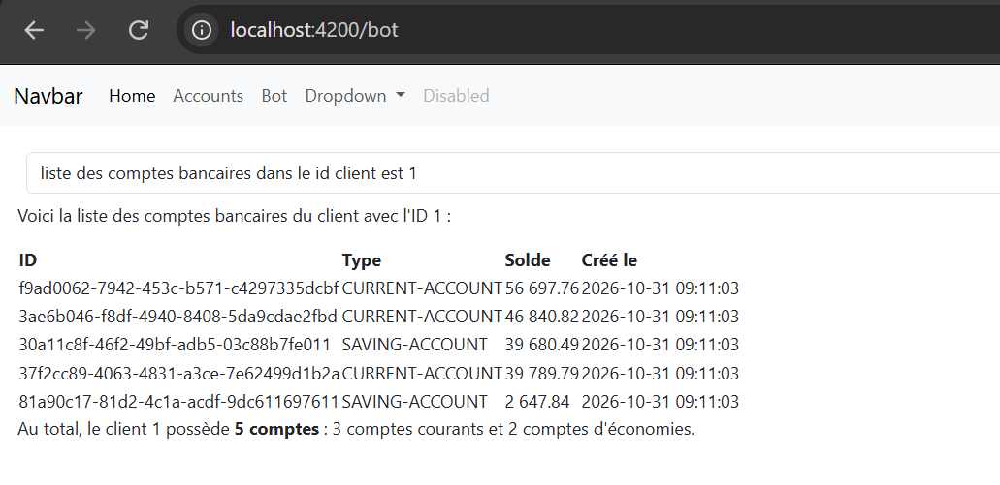

# EBank Microservices App : Partie 3 - Application front-end Angular

---

## Table des matières

1. [Objectif de la Partie 3](#1-objectif-de-la-partie-3)
2. [Architecture](#2-architecture)
3. [Technologies utilisées](#3-technologies-utilisées)
4. [Création du projet Angular](#4-création-du-projet-angular)
5. [Intégration de Bootstrap et mise en place du template](#5-intégration-de-bootstrap-et-mise-en-place-du-template)
6. [Composant de consultation des comptes](#6-composant-de-consultation-des-comptes)
7. [Configuration CORS dans la Gateway](#7-configuration-cors-dans-la-gateway)
8. [Modèle de données et gestion de l'état des requêtes](#8-modèle-de-données-et-gestion-de-létat-des-requêtes)
9. [Indicateur de chargement : service et intercepteur HTTP](#9-indicateur-de-chargement--service-et-intercepteur-http)
10. [Composant Chatbot](#10-composant-chatbot)
11. [Affichage des réponses au format Markdown](#11-affichage-des-réponses-au-format-markdown)
12. [Streaming des réponses du chatbot](#12-streaming-des-réponses-du-chatbot)
13. [Nouveautés Angular 21 et pistes d'évolution](#13-nouveautés-angular-21-et-pistes-dévolution)
14. [Lancement du projet](#14-lancement-du-projet)
15. [Conclusion générale](#15-conclusion-générale)

---

## 1. Objectif de la Partie 3

Cette dernière partie complète l'architecture avec une application web Angular qui offre deux manières d'accéder aux fonctionnalités de la plateforme :

- une interface classique de consultation des comptes bancaires ;
- une interface de dialogue avec le chatbot développé en Partie 2, avec réponses mises en forme et affichées en streaming.

Elle illustre également plusieurs bonnes pratiques Angular : typage des données, gestion explicite des états de requête (succès, erreur), centralisation de l'indicateur de chargement par un intercepteur HTTP et utilisation des signaux.

---

## 2. Architecture

Le front-end communique exclusivement avec la Gateway (port 9999), point d'entrée unique de l'architecture. Il ne contacte jamais directement les micro-services.

| Fonctionnalité du front | Route de l'application | Service appelé via la Gateway |
|---|---|---|
| Liste des comptes | `/accounts` | EBank-Service |
| Dialogue avec le chatbot | `/bot` | EBank-Bot |

Schéma de flux :

1. Le navigateur charge l'application Angular (port 4200).
2. Les composants envoient des requêtes HTTP à la Gateway (port 9999).
3. La Gateway résout dynamiquement le service cible via Eureka et transmet la requête.
4. La réponse remonte jusqu'au composant, qui l'affiche.

Pour l'interface de chat, la requête traverse en plus l'agent IA et les serveurs MCP décrits en Partie 2.

---

## 3. Technologies utilisées

| Catégorie | Technologie |
|---|---|
| Framework front-end | Angular 21 |
| Environnement | Node.js 22, npm, Angular CLI |
| Styles et composants | Bootstrap 5, Bootstrap Icons |
| Programmation réactive | RxJS (Observable, map, catchError, finalize) |
| Gestion d'état locale | Signaux Angular |
| Affichage Markdown | ngx-markdown |
| Communication | HttpClient, intercepteur HTTP fonctionnel |

---

## 4. Création du projet Angular

Un dossier `angular-front` est créé à la racine du dépôt, à côté des micro-services. Le projet est généré avec Angular CLI, dans le dossier courant, avec les options suivantes : feuilles de style CSS, sans rendu côté serveur (SSR) et sans agent d'intelligence artificielle de développement.

Les versions des outils sont vérifiées au préalable : Angular CLI doit être installé globalement et Node.js doit être compatible avec la version 21 d'Angular. L'application se lance en mode développement et est accessible sur le port 4200.

---

## 5. Intégration de Bootstrap et mise en place du template

### 5.1 Installation de Bootstrap

Les paquets `bootstrap` et `bootstrap-icons` sont installés avec npm. Les feuilles de style de Bootstrap et des icônes sont importées dans la feuille de styles globale (`styles.css`).

Pour que les composants dynamiques de Bootstrap (menu déroulant, barre de navigation repliable) fonctionnent, le script JavaScript groupé (`bootstrap.bundle`) est déclaré dans la configuration du projet (`angular.json`). Un redémarrage du serveur de développement est nécessaire après cette modification.

### 5.2 Template de l'application

Le composant racine reprend une barre de navigation (navbar) Bootstrap, complétée par la directive `router-outlet`, qui définit la zone où s'affichent les composants correspondant à chaque route. Les liens de la barre de navigation utilisent `routerLink` au lieu des liens HTML classiques, afin de naviguer sans recharger la page.

---

## 6. Composant de consultation des comptes

Le composant `accounts` est créé avec Angular CLI. Dans la version 21, le suffixe « Component » n'est plus ajouté au nom de la classe par défaut. Il est déclaré dans le fichier de routes avec le chemin `/accounts`.

Fonctionnement :

- le service `HttpClient` est injecté avec la fonction `inject()`. Cette approche est préférée à l'injection par constructeur car elle fonctionne aussi hors d'une classe, par exemple dans un intercepteur fonctionnel ;
- au chargement du composant, une requête GET est envoyée à la Gateway pour récupérer la liste des comptes (route de `EBank-Service`) ;
- la variable qui reçoit la réponse est un `Observable`, nommé avec le suffixe `$` par convention ;
- dans le template, le pipe `async` s'abonne à l'observable et fournit les données dès leur arrivée, sans appel manuel à `subscribe` ;
- la liste est affichée dans un tableau Bootstrap, avec une boucle sur les comptes (identifiant, solde, date de création, type, identifiant du client).

---

## 7. Configuration CORS dans la Gateway

Lors du premier test, le tableau reste vide et la console du navigateur signale une erreur de type **CORS** (Cross-Origin Resource Sharing). Cette erreur survient car l'application Angular (port 4200) et le backend (port 9999) n'ont pas la même origine, et le backend n'autorise pas encore ce type d'échange.

La solution retenue consiste à configurer le CORS **une seule fois au niveau de la Gateway**, plutôt que dans chaque micro-service. Dans la configuration de la Gateway, une configuration CORS globale est ajoutée : toutes les URL, toutes les origines, toutes les méthodes et tous les en-têtes sont autorisés (configuration volontairement permissive, adaptée au développement et à restreindre en production). Après redémarrage de la Gateway, la liste des comptes s'affiche correctement.

---

## 8. Modèle de données et gestion de l'état des requêtes

Pour structurer le code, un dossier `model` est créé avec des interfaces TypeScript :

| Élément | Rôle |
|---|---|
| Interface `Account` | Décrit un compte : identifiant, solde, date de création, type et identifiant du client. Certains champs peuvent être optionnels. |
| Énumération `RequestStatus` | Deux valeurs : succès et erreur. |
| Interface `AccountListState` | Regroupe la liste des comptes, le statut de la requête et un message d'erreur éventuel. |

Le composant ne manipule plus directement la liste brute renvoyée par le serveur. Un pipeline RxJS la transforme en objet d'état :

- l'opérateur `map` convertit la liste reçue en un `AccountListState` avec le statut « succès » ;
- l'opérateur `catchError` intercepte les erreurs HTTP et retourne un état avec le statut « erreur » et le texte de l'erreur (par exemple « Not Found »).

Dans le template, un test sur le statut permet d'afficher soit le tableau des comptes (en cas de succès), soit un message d'erreur en rouge (en cas d'échec). Cette approche offre un typage complet (l'éditeur propose les attributs des comptes), une gestion centralisée des erreurs et une interface plus informative. Le comportement d'erreur a été validé en pointant volontairement vers une route inexistante.

---

## 9. Indicateur de chargement : service et intercepteur HTTP

Afficher un indicateur de chargement (spinner) dans chaque composant serait répétitif. Le chargement est donc géré de manière centralisée :

1. **Service de chargement (`LoadingService`)** : fournit un état booléen sous forme de **signal** et deux opérations pour l'activer ou le désactiver, ainsi qu'un accès en lecture seule à la valeur.
2. **Intercepteur HTTP fonctionnel (`loadingInterceptor`)** : intercepte chaque requête sortante. Avant l'envoi, il active l'état de chargement ; une fois la réponse reçue (opérateur `finalize`), il le désactive. Le service y est injecté avec `inject()`.
3. **Enregistrement de l'intercepteur** : dans la configuration de l'application (`app.config`), l'intercepteur doit être déclaré explicitement via la configuration du client HTTP (`provideHttpClient` avec `withInterceptors`). Cette étape avait d'abord été oubliée, ce qui expliquait l'absence de spinner lors du premier test.
4. **Affichage** : les composants injectent le service et affichent un spinner Bootstrap tant que l'état de chargement est actif.

Dans Angular 21, `provideHttpClient` n'est plus indispensable pour utiliser `HttpClient` de base, mais il reste nécessaire dès que l'on veut déclarer des intercepteurs.

---

## 10. Composant Chatbot

Un second composant, `bot`, est créé avec une route `/bot` et un lien dans la barre de navigation. Son interface comprend :

- une zone de saisie de texte et un bouton avec une icône de recherche de Bootstrap Icons, alignés sur la même ligne ;
- une zone de réponse affichée dans une carte Bootstrap ;
- le spinner de chargement du service centralisé.

Fonctionnement :

- la saisie est liée à une variable du composant par `ngModel` (module de formulaires), ce qui évite de recourir à des formulaires réactifs pour un champ unique ;
- au clic sur le bouton, la méthode d'interrogation de l'agent envoie une requête GET à la route de chat du bot via la Gateway, avec la question en paramètre ;
- le résultat est stocké dans un observable affiché avec le pipe `async`.

Point d'attention : le chatbot retourne du texte brut et non du JSON, alors que le client HTTP d'Angular attend du JSON par défaut. Il faut donc préciser que le type de réponse attendu est `text`, faute de quoi la réponse n'est pas exploitable alors qu'elle est bien reçue (visible dans l'onglet réseau du navigateur).

---

## 11. Affichage des réponses au format Markdown

Les réponses du LLM contiennent du Markdown (listes, tableaux, mise en gras). Pour les afficher correctement, la bibliothèque **ngx-markdown** est utilisée :

1. installation du paquet avec npm ;
2. déclaration du fournisseur `provideMarkdown` dans la configuration de l'application ;
3. remplacement de l'affichage brut de la réponse par le composant `markdown`, qui reçoit le texte à mettre en forme.

Le rendu devient nettement plus lisible. L'agent peut en particulier présenter les comptes sous forme de tableaux avec bordures lorsque l'utilisateur le demande. Les interactions suivantes ont été testées depuis l'interface : liste des comptes et des clients, comptes d'un client précis, mise en forme en tableau et ajout d'un compte en langage naturel, vérifié ensuite par une nouvelle consultation.

---

## 12. Streaming des réponses du chatbot

### 12.1 Motivation

Avec le mode de communication synchrone, l'utilisateur attend la fin complète de la génération avant de voir la moindre réponse. Pour de longues réponses, il est préférable d'afficher le texte au fur et à mesure de sa production par le LLM, comme le font les interfaces de chat modernes. Cette approche sera aussi déterminante pour des interactions vocales.

### 12.2 Adaptation du backend (EBank-Bot)

- Dans l'agent, une seconde méthode de chat est ajoutée : au lieu d'un appel bloquant qui attend la réponse complète, elle utilise le mode flux de Spring AI et retourne un `Flux` de texte (flux réactif).
- Dans le contrôleur, un nouvel endpoint de chat en streaming retourne ce `Flux`.
- Les deux modes (synchrone et streaming) coexistent : l'ancien endpoint est conservé.

Le test direct dans le navigateur confirme que le texte arrive progressivement.

### 12.3 Adaptation du front-end

Une seconde méthode d'interrogation est ajoutée au composant. Elle se distingue de la première par l'observation des **événements HTTP** (option `observe: events`, avec le suivi de la progression du téléchargement) plutôt que de la seule réponse finale. Les événements sont traités avec l'opérateur `map` :

| Type d'événement HTTP | Traitement |
|---|---|
| Requête envoyée | Un objet d'état indique que la requête est partie |
| Progression du téléchargement | Le fragment de texte partiel reçu est récupéré et transmis au composant |
| Réponse finale | Le corps complet de la réponse est transmis |
| Autres événements | Retournés tels quels, sans traitement |

Dans le template, seuls les événements de type « réponse » sont affichés ; le texte s'enrichit au fur et à mesure que les fragments arrivent. Le bouton d'envoi est relié à cette nouvelle méthode, et l'URL appelée est celle de l'endpoint de streaming du bot.

---

## 13. Nouveautés Angular 21 et pistes d'évolution

### 13.1 Nouveautés mises en œuvre

- le composant généré sans suffixe « Component » ;
- `HttpClient` disponible sans déclaration explicite du fournisseur ;
- l'usage généralisé de `inject()` et des **signaux** pour l'état de chargement.

### 13.2 Formulaires à base de signaux (Signal Forms)

Angular 21 introduit les **Signal Forms**, une approche plus légère que les formulaires réactifs traditionnels (`FormGroup`). Les validateurs (par exemple, solde minimum de 1000 ou type obligatoire de quatre caractères au minimum) sont déclarés directement sur les champs du modèle, la liaison au template se fait via une directive de champ, et les messages d'erreur s'affichent selon l'état de validation. Cette approche a été présentée comme exemple de formulaire d'ajout de compte, mais n'a pas été intégrée à la version finale de l'application.

### 13.3 Pistes d'évolution

- ajout d'un composant de gestion des clients (consultation, création) ;
- formulaires d'ajout de comptes avec validation ;
- restriction de la configuration CORS aux origines légitimes ;
- sécurisation de l'ensemble de l'architecture avec Keycloak (authentification centralisée) ;
- déploiement conteneurisé de l'ensemble des services avec Docker Compose ;
- ajout d'un système RAG pour permettre au chatbot de répondre à des questions sur des procédures documentaires.

---

## 14. Lancement du projet

Prérequis : Node.js 22, Angular CLI, et l'ensemble du backend démarré.

Ordre de démarrage du backend :

1. `discovery-service`
2. `customer-service` et `ebank-service`
3. `gateway-service`
4. `ebank-bot`

Ensuite, depuis le dossier `angular-front`, installer les dépendances avec npm puis lancer l'application Angular (`ng serve`). Elle est accessible sur le port 4200.

| Ressource | URL |
|---|---|
| Application Angular | http://localhost:4200 |
| Liste des comptes (route Angular) | http://localhost:4200/accounts |
| Chatbot (route Angular) | http://localhost:4200/bot |
| Eureka Dashboard | http://localhost:8761 |
| Gateway | http://localhost:9999 |

---

## 15. Conclusion générale

Le projet couvre une architecture micro-services complète et moderne, de la couche données jusqu'à l'interface utilisateur :

- **Partie 1** : micro-services métier, découverte de services, Gateway, communication synchrone avec OpenFeign et tolérance aux pannes avec Resilience4J ;
- **Partie 2** : agent conversationnel basé sur Spring AI, outils métier exposés par MCP, et ouverture du chatbot sur Telegram et Discord ;
- **Partie 3** : application Angular avec consultation des comptes, gestion des états de requête, indicateur de chargement centralisé et interface de chat avec rendu Markdown et streaming.

Cette réalisation met en évidence la complémentarité des briques techniques : Spring Cloud pour l'infrastructure distribuée, MCP pour l'accès contrôlé de l'IA aux services métier et Angular pour l'expérience utilisateur.
